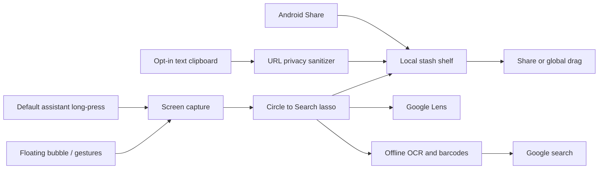

<p align="center">
  
</p>

<h1 align="center">StashDrop</h1>
<p align="center"><strong>A little space. For everything.</strong><br/>A native Android floating shelf for notes, links, files, and visual cutouts.</p>

<p align="center">
  
  
  
  
  
</p>

<p align="center">
  <a href="#ui-gallery">UI gallery</a> · <a href="#what-you-can-do">Features</a> · <a href="#build-and-install">Build &amp; install</a> · <a href="docs/PLATFORM_SUPPORT.md">Platform support</a> · <a href="docs/DEVICE_VALIDATION.md">Device testing</a>
</p>

## What is StashDrop?

Catch something useful without losing your place. Share a link into your shelf, save a note, circle part of the screen, extract text, and send a selection back to another app. A thumb-friendly floating dock keeps the shelf nearby, while spring motion and aurora shaders give each interaction a fluid visual language.

**Built with Kotlin, Jetpack Compose, Room, DataStore, ML Kit, and optional Shizuku.** The built-in OCR/barcode workflow uses bundled on-device models and needs no backend API key.

> **Current stage:** the debug app builds, logic tests pass, and host rendering is available. Real-device behavior, Google eligibility, cross-app compatibility, and release qualification remain to be verified. See [validation](docs/VERIFICATION.md).

## UI gallery

These images render the **actual Compose components with sample content** using Paparazzi. They are host-rendered UI previews, not screenshots from a phone. Permission states and stash contents are presentation fixtures.

<table>
  <tr>
    <th>Overview &amp; motion playground</th>
    <th>Your stash shelf</th>
    <th>Controls &amp; connections</th>
  </tr>
  <tr>
    <td width="33%"><a href="docs/assets/screenshots/overview.png"></a></td>
    <td width="33%"><a href="docs/assets/screenshots/shelf.png"></a></td>
    <td width="33%"><a href="docs/assets/screenshots/controls.png"></a></td>
  </tr>
</table>

<table>
  <tr><th>Floating shelf component</th><th>Circle to Search selection canvas</th></tr>
  <tr>
    <td width="50%" align="center"><a href="docs/assets/screenshots/floating-shelf.png"></a></td>
    <td width="50%" align="center"><a href="docs/assets/screenshots/circle-canvas.png"></a></td>
  </tr>
</table>

<details>
<summary><strong>See all Controls in one long-form render</strong></summary>

<p align="center"><a href="docs/assets/screenshots/controls-full.png"></a></p>

</details>

See [the visual guide](docs/UI_GALLERY.md) for image provenance, regeneration commands, and a map of the implementation.

## Motion, made visible

<table>
  <tr><th>Finger-driven aurora</th><th>Liquid metaball field</th></tr>
  <tr>
    <td width="64%"></td>
    <td width="36%"></td>
  </tr>
</table>

These loops render the app's shader source with desktop Skia. Android uses AGSL on API 33+ and Canvas fallbacks on older releases. They demonstrate the shader output, not measured phone frame rates.

- **Follow:** damping ratio `0.78`, stiffness `650`.
- **Liquid expansion:** damping ratio `0.68`, stiffness `380`.
- **Card landing:** damping ratio `0.62`, stiffness `420`.
- **Flight:** cubic Bezier trajectories projected from drag velocity.
- **Feedback:** progressive pull ticks and confirmation haptics, with supported-device fallbacks.

Explore [shaders](app/src/main/java/com/vibe/stashdrop/core/shaders), [physics](app/src/main/java/com/vibe/stashdrop/core/physics), and [haptics](app/src/main/java/com/vibe/stashdrop/core/haptics).

## What you can do

| Feature | Implementation | Availability |
| --- | --- | --- |
| Floating thumb dock | Draggable dock, magnetic edge snap, idle peek, foreground notification | Overlay permission required |
| Local stash shelf | Notes, links, imported files/images, collections, deletion | Room + private app files |
| Share into StashDrop | Android `SEND` and `SEND_MULTIPLE` receivers | Up to 30 attachments; 50 MB per attachment |
| Circle to Search | Screen capture, freehand lasso, Google search of circled text, Lens image search, copy/stash/share | Capture permission or consent required |
| Offline text & codes | Bundled Latin-script ML Kit text recognition and barcode scanning | Built-in path; no backend key |
| Default digital assistant | Long-press home opens StashDrop Circle to Search; set or restore from Settings | One tap with Shizuku; otherwise the system default-apps screen |
| In-app setup | Overlay, notifications, screenshot access and assistant status with one-tap fixes | Shizuku applies them directly; otherwise opens the exact system screen |
| Haptic feedback | Detents while dragging the bubble and drawing a circle; clicks when stacking cards | Toggle in Settings |
| Clean links | Removes `utm_*`, `fbclid`, `gclid`, `si`, `igshid`, `ref`, and related tracking keys | Preserves raw query encoding and prose punctuation |
| Background text clipboard | Opt-in shell listener plus permitted foreground fallback | Shizuku/OEM access rules apply; off by default |
| Multi-select & global drag | Selection stack, custom drag shadow, URI read grants | Receiver must accept the content |
| WhatsApp & standard sharing | Single/multiple attachment intents with text | App and MIME compatibility dependent |
| Gesture strips | Swipe up, corner pull, 400 ms hold, double tap | Opt-in touch regions above system navigation |
| Assistant management | Shizuku setting change with saved values for restoration | Explicit Controls action |

For exact OS boundaries—including protected content, file clipboard access, and system home-button interception—read [platform support](docs/PLATFORM_SUPPORT.md).

## Build and install

**Requirements:** JDK 17+ (the cloud build uses JDK 21), Android SDK platform 35, and build-tools 35.0.0. The included Gradle 8.11.1 wrapper has its distribution SHA-256 pinned.

```bash
git clone https://github.com/ankitchanki/StashDrop.git StashDrop
cd StashDrop
# Set ANDROID_HOME to your SDK, or add sdk.dir to local.properties.
./gradlew :app:assembleDebug :app:testDebugUnitTest :app:lintDebug
```

The APK is created at:

```text
app/build/outputs/apk/debug/app-debug.apk
```

Install on a connected device:

```bash
adb install -r app/build/outputs/apk/debug/app-debug.apk
adb shell am start -n com.vibe.stashdrop/.MainActivity
```

Package: `com.vibe.stashdrop` · Minimum SDK: `28` · Target SDK: `35`.

The debug APK uses a development signing key. Signed release builds require a separate production key and enable code/resource shrinking; see [release signing and publication](docs/RELEASING.md). For the prepared cloud toolchain, see [cloud environment instructions](docs/CLOUD_ENVIRONMENT.md).

### First run

1. Open StashDrop, go to **Settings → Setup**, and fix anything marked Off. With Shizuku connected, **Set up everything with Shizuku** does it in one tap.
2. On Home, tap **Show floating bubble**. Tap the bubble for your shelf; hold it (or swipe up on the gesture strip) for Circle to Search.
3. Optional: set **Default assistant → Use StashDrop** so long-pressing home opens Circle to Search instead of Gemini.
4. Circle an area, then search its text on Google, search the image with Lens, copy, stash, or share it.
5. Share a note, link, photo, or file **to StashDrop**, or add a note from the Shelf tab. Gesture strips and auto-stash are opt-in.

## Signed releases and changelog

Version `0.2.0` uses Android version code `3` and the existing StashDrop production certificate. Signed APK/app-bundle packages include checksums, the public certificate, and a verification report. Version-tag builds use [GitHub Actions](.github/workflows/android.yml); the four signing secrets must be configured before publication. Private signing keys are kept separately.

- [Changelog](CHANGELOG.md)
- [Version 0.2.0 notes](docs/releases/v0.2.0.md)
- [Version 0.1.1 notes](docs/releases/v0.1.1.md)
- [Release build and publication instructions](docs/RELEASING.md)
- [GitHub Releases](https://github.com/ankitchanki/StashDrop/releases) for versions that have completed publication

A release build/signature check does not replace the outstanding [device validation](docs/DEVICE_VALIDATION.md).

## How it fits together



```text
app/src/main/java/com/vibe/stashdrop/
├── core/
│   ├── shizuku/       Binder lifecycle, shell bridge, settings and capture
│   ├── shaders/       Aurora, metaballs and specular glass
│   ├── physics/       Spring specs and magnetic trajectories
│   ├── hiddenapi/     Defensive hidden-API initialization
│   └── haptics/       Pull ticks and confirmation feedback
├── features/
│   ├── floatingdock/  Overlay service, gestures, icon and fan-out shelf
│   ├── dragdrop/      Global stack shadow and in-app flight feedback
│   ├── circletosearch/ Capture routing, lasso, ML Kit and Lens sharing
│   ├── stashshelf/    Room, private files, collections and URL cleaning
│   └── clipboard/     Opt-in Shizuku text clipboard listener
└── ui/
    ├── theme/         Dark surface, periwinkle and mint tokens
    └── dashboard/     Overview, shelf, controls and motion playground
```

## Data and permissions

Stash content lives in the app's private database and files. FileProvider exposes selected attachments with temporary read grants. Clipboard text is not logged; the bounded history table stores digests rather than duplicate payloads. Auto-stash can retain sensitive copied text and is **off by default**. Delete saved items from the Shelf tab.

Shizuku and accessibility are optional capabilities. The built-in path can ask for MediaProjection consent instead. StashDrop does not bypass protected/DRM content, and a successful Binder call does not prove that Google's UI appeared.

## Verification

The initial implementation passed its debug build, **12 logic tests**, shader compilation/raster checks, APK signature verification, and 16 KB alignment checks. Android lint completed with **zero errors** and documented warnings.

Paparazzi renders the README gallery from the production Compose components. See [the visual guide](docs/UI_GALLERY.md) for regeneration. Rendering previews does not validate foreground services, capture grants, clipboard access, Google eligibility, WhatsApp drops, or real-device performance.

- [Build verification](docs/VERIFICATION.md)
- [Device validation checklist](docs/DEVICE_VALIDATION.md)
- [Platform support and fallbacks](docs/PLATFORM_SUPPORT.md)

## Topics

[android](https://github.com/topics/android) · [kotlin](https://github.com/topics/kotlin) · [jetpack-compose](https://github.com/topics/jetpack-compose) · [material3](https://github.com/topics/material3) · [shizuku](https://github.com/topics/shizuku) · [productivity](https://github.com/topics/productivity) · [clipboard-manager](https://github.com/topics/clipboard-manager) · [floating-window](https://github.com/topics/floating-window) · [screen-capture](https://github.com/topics/screen-capture) · [circle-to-search](https://github.com/topics/circle-to-search) · [ocr](https://github.com/topics/ocr) · [ml-kit](https://github.com/topics/ml-kit) · [room-database](https://github.com/topics/room-database) · [datastore](https://github.com/topics/datastore) · [agsl](https://github.com/topics/agsl) · [android-development](https://github.com/topics/android-development) · [drag-and-drop](https://github.com/topics/drag-and-drop) · [privacy](https://github.com/topics/privacy) · [kotlin-coroutines](https://github.com/topics/kotlin-coroutines) · [paparazzi](https://github.com/topics/paparazzi)

The repository description and full set of 20 topics are maintained in [repository metadata](.github/repository-metadata.json). An owner with GitHub API access can apply them with:

```bash
python scripts/apply-github-metadata.py
```

## Contributing

Read [CONTRIBUTING.md](CONTRIBUTING.md) for build checks, visual assets, and useful device reports. A license has not been selected for this repository.

---

<p align="center">Built for the ideas you want to keep close.</p>
