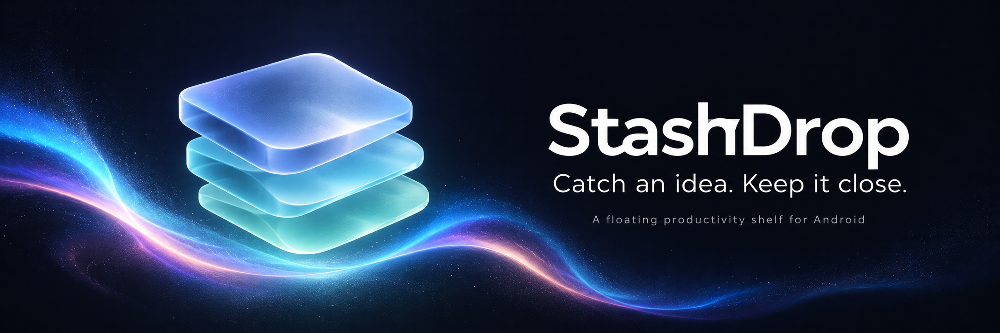
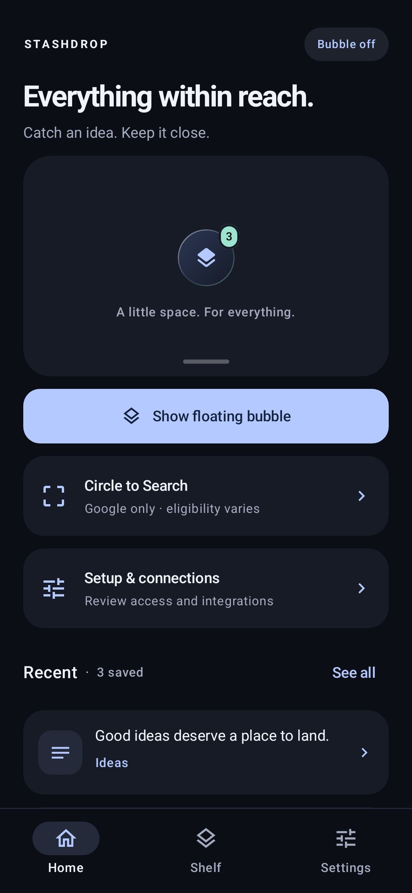
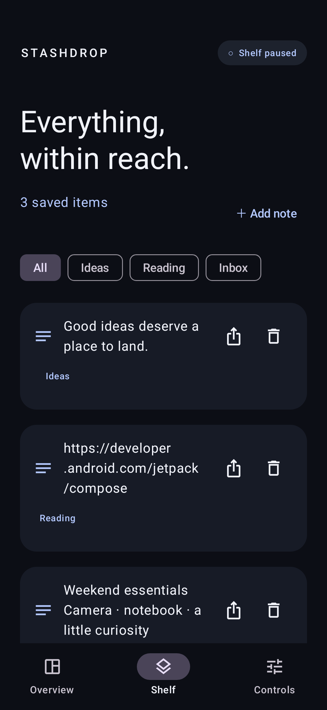
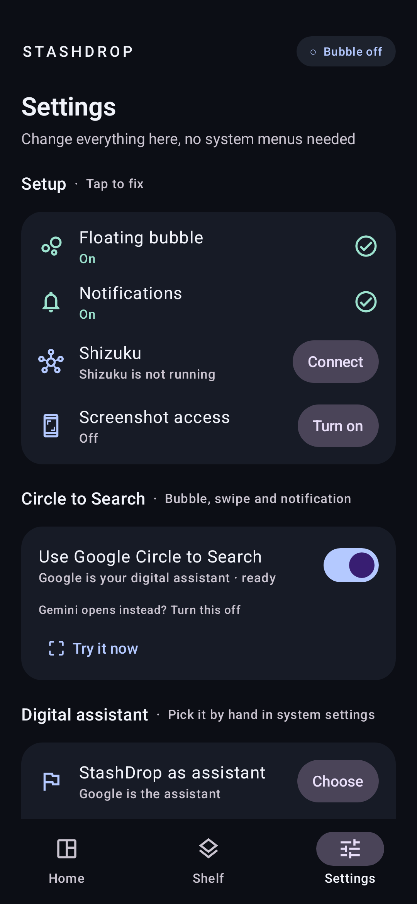
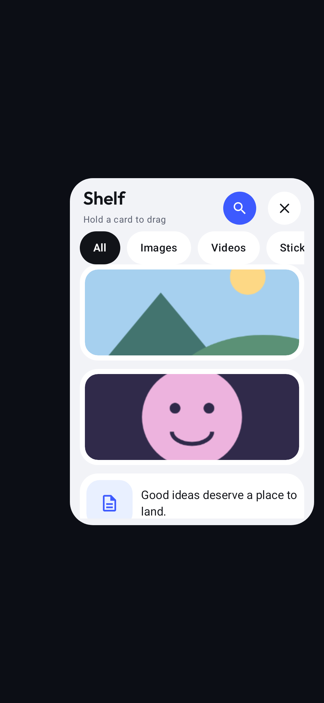
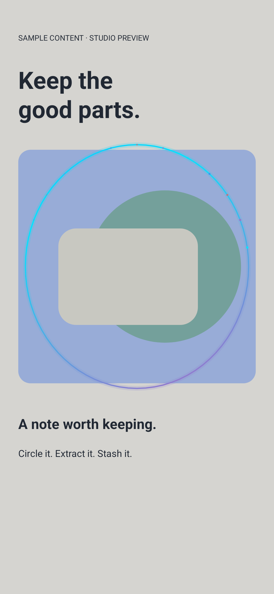
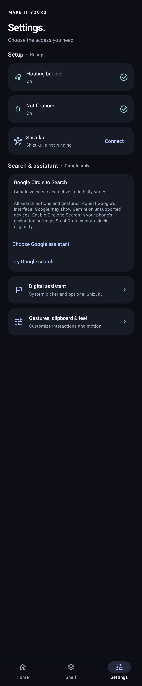
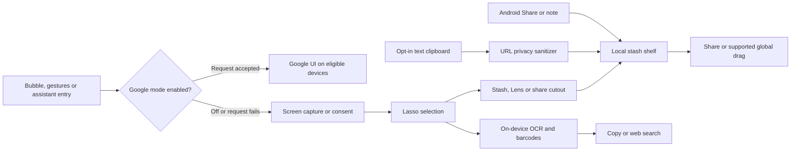

<p align="center">
  
</p>

<h1 align="center">StashDrop</h1>
<p align="center"><strong>A little space. For everything.</strong><br/>A native Android floating shelf for notes, links, files, and visual cutouts.</p>

<p align="center">
  
  
  
  
  
</p>

<p align="center">
  <a href="#ui-gallery">UI gallery</a> · <a href="#what-you-can-do">Features</a> · <a href="#build-and-install">Build &amp; install</a> · <a href="docs/PLATFORM_SUPPORT.md">Platform support</a> · <a href="docs/DEVICE_VALIDATION.md">Device testing</a>
</p>

## What is StashDrop?

Catch something useful without losing your place. Share a link into your shelf, save a note, circle part of the screen, extract text, and send a selection back to another app. A thumb-friendly floating dock keeps the shelf nearby, while spring motion and aurora shaders give each interaction a fluid visual language.

**Built with Kotlin, Jetpack Compose, Room, DataStore, ML Kit, and optional Shizuku.** The built-in OCR/barcode workflow uses bundled on-device models and needs no backend API key.

**[Download the signed Android APK — v0.4.0](https://github.com/ankitchanki/StashDrop/releases/download/v0.4.0/StashDrop-v0.4.0.apk)** · [Release notes and checksums](https://github.com/ankitchanki/StashDrop/releases/tag/v0.4.0)

Android 9+ · No account or backend API key · Local shelf storage · Optional Shizuku integration. The published release preserves the original production signing certificate for compatible updates. Its build passed **32 tests**, signature checks, and 16 KB alignment checks. Device/OEM behavior and native Google eligibility still need the [device checklist](docs/DEVICE_VALIDATION.md).

### Everyday workflows

- **Keep a useful link:** use another app's Share menu → StashDrop. Tracking parameters are removed from saved text links; move the item into a collection and share it again later.
- **Read text inside an image:** turn off **Use Google Circle to Search** in Settings, invoke search, allow capture, and circle the text. Copy the on-device recognition result, search it, or keep the image cutout.
- **Send several saved items:** open the floating shelf, select cards, and use Share or WhatsApp. Global drag is available when the receiving app supports its content types.

Read the [complete feature guide](docs/FEATURE_GUIDE.md), [architecture](docs/ARCHITECTURE.md), and [improvements and future UI roadmap](docs/ROADMAP.md).

## UI gallery

These images render the **actual Compose components with sample content** using Paparazzi. They are host-rendered UI previews, not screenshots from a phone. Permission states and stash contents are presentation fixtures.

<table>
  <tr>
    <th>Home &amp; recent items</th>
    <th>Your stash shelf</th>
    <th>Settings &amp; connections</th>
  </tr>
  <tr>
    <td width="33%"><a href="docs/assets/screenshots/overview.png"></a></td>
    <td width="33%"><a href="docs/assets/screenshots/shelf.png"></a></td>
    <td width="33%"><a href="docs/assets/screenshots/controls.png"></a></td>
  </tr>
</table>

<table>
  <tr><th>Floating shelf component</th><th>Circle to Search selection canvas</th></tr>
  <tr>
    <td width="50%" align="center"><a href="docs/assets/screenshots/floating-shelf.png"></a></td>
    <td width="50%" align="center"><a href="docs/assets/screenshots/circle-canvas.png"></a></td>
  </tr>
</table>

<details>
<summary><strong>See all Settings in one long-form render</strong></summary>

<p align="center"><a href="docs/assets/screenshots/controls-full.png"></a></p>

</details>

The dedicated [interaction settings screen](docs/assets/screenshots/interactions.png) is also rendered from production Compose.

See [the visual guide](docs/UI_GALLERY.md) for image provenance, regeneration commands, and a map of the implementation.

## Motion, made visible

<table>
  <tr><th>Finger-driven aurora</th><th>Liquid metaball field</th></tr>
  <tr>
    <td width="64%"></td>
    <td width="36%"></td>
  </tr>
</table>

These loops render the app's shader source with desktop Skia. Android uses AGSL on API 33+ and Canvas fallbacks on older releases. They demonstrate the shader output, not measured phone frame rates.

- **Follow:** damping ratio `0.78`, stiffness `650`.
- **Liquid expansion:** damping ratio `0.68`, stiffness `380`.
- **Card landing:** damping ratio `0.62`, stiffness `420`.
- **Flight:** cubic Bezier trajectories projected from drag velocity.
- **Feedback:** progressive pull ticks and confirmation haptics, with supported-device fallbacks.

Explore [shaders](app/src/main/java/com/vibe/stashdrop/core/shaders), [physics](app/src/main/java/com/vibe/stashdrop/core/physics), and [haptics](app/src/main/java/com/vibe/stashdrop/core/haptics).

## What you can do

| Feature | Implementation | Availability |
| --- | --- | --- |
| Floating thumb dock | Draggable bubble, magnetic edge snap, idle peek, drag-to-X dismiss, foreground notification | Overlay permission required |
| Local stash shelf | Notes, links, files/images, collections, multi-selection, batch share/move and confirmed deletion | Room + private app files |
| Share into StashDrop | Android `SEND` and `SEND_MULTIPLE` receivers | Up to 30 attachments; 50 MB per attachment |
| Google Circle to Search | Opens Google's own Circle to Search from the bubble, bottom swipe, notification and Settings | Google voice service must be active; Google decides device eligibility |
| StashDrop circle screen | Built-in fallback: capture, freehand lasso, Google search of circled text, Lens, copy/stash/share | Capture permission or consent required |
| Offline text & codes | Bundled Latin-script ML Kit text recognition and barcode scanning | Built-in path; no backend key |
| Digital assistant | Choose StashDrop for assistant gestures; optional Shizuku Connect keeps Google's voice service available for native search | Android 10+ assistant management; device gesture support varies |
| Crash reports | The last crash is shown at launch with a Copy button | Stored only on the phone |
| In-app setup | Overlay, notifications, screenshot access and assistant status with one-tap fixes | Optional Shizuku automation; manual system settings remain available |
| Haptic feedback | Detents while dragging the bubble and drawing a circle; clicks when stacking cards | Toggle in Settings |
| Clean links | Removes `utm_*`, `fbclid`, `gclid`, `si`, `igshid`, `ref`, and related tracking keys | Preserves raw query encoding and prose punctuation |
| Background text clipboard | Opt-in shell listener plus permitted foreground fallback | Shizuku/OEM access rules apply; off by default |
| Multi-select & global drag | Selection stack, custom drag shadow, URI read grants | Receiver must accept the content |
| WhatsApp & standard sharing | Single/multiple attachment intents with text | App and MIME compatibility dependent |
| Gesture strips | Swipe up, corner pull, 400 ms hold, double tap | Strips and swipe-up enabled by default; require the running overlay; other gestures off by default |
| Assistant management | Shizuku setting change with saved values for restoration | Explicit Settings actions; system/OEM support varies |

For instructions, defaults, storage behavior, and troubleshooting for every feature, see the [feature guide](docs/FEATURE_GUIDE.md).

For exact OS boundaries—including protected content, file clipboard access, and system home-button interception—read [platform support](docs/PLATFORM_SUPPORT.md).

## Build and install

**Requirements:** JDK 17+ (the cloud build uses JDK 21), Android SDK platform 35, and build-tools 35.0.0. The included Gradle 8.11.1 wrapper has its distribution SHA-256 pinned.

```bash
git clone https://github.com/ankitchanki/StashDrop.git StashDrop
cd StashDrop
# Set ANDROID_HOME to your SDK, or add sdk.dir to local.properties.
./gradlew :app:assembleDebug :app:testDebugUnitTest :app:lintDebug
```

The APK is created at:

```text
app/build/outputs/apk/debug/app-debug.apk
```

Install on a connected device:

```bash
adb install -r app/build/outputs/apk/debug/app-debug.apk
adb shell am start -n com.vibe.stashdrop/.MainActivity
```

Package: `com.vibe.stashdrop` · Minimum SDK: `28` · Target SDK: `35`.

The debug APK uses a development signing key. Signed release builds require a separate production key and enable code/resource shrinking; see [release signing and publication](docs/RELEASING.md). For the prepared cloud toolchain, see [cloud environment instructions](docs/CLOUD_ENVIRONMENT.md).

### First run

Gesture, clipboard, haptic, and spring settings now live in **Settings → Gestures, clipboard & feel**. Tap Shelf cards for the selection bar; More selection actions provides Move and Delete.

1. Install the signed APK above and open **Settings → Setup**. Allow the floating bubble; enable notifications where required. Shizuku is optional, and its setup shortcuts require a running, authorized Shizuku service.
2. On **Home**, tap **Show floating bubble**. Tap the bubble to open the shelf; hold it to search. Drag to the bottom X to hide it.
3. In **Settings → Search & assistant**, leave **Use Google Circle to Search** on to request Google's UI. If Gemini opens instead, turn the toggle off for StashDrop's built-in capture/lasso workflow.
4. The built-in path tries Shizuku capture, then enabled accessibility screenshot access on Android 11+, then asks for screen-sharing consent. Circle an area and choose Search, Lens, Copy, Stash, or Share.
5. Add a note from **Shelf**, or share text, photos, and files into StashDrop from other apps. Bottom gesture strips and swipe-up start enabled; corner swipe, strip hold, and double tap start disabled. **Auto-stash copied text starts off.**
6. Optionally choose StashDrop under **Settings → Digital assistant** for supported system assistant gestures. With StashDrop selected, **Connect Google** through Shizuku can keep Google's voice service active. Google's eligibility rules still apply. See [assistant setup](docs/FEATURE_GUIDE.md#digital-assistant-and-shizuku).

## Signed releases and changelog

Version `0.4.0` uses Android version code `7` and the original StashDrop production certificate. Earlier builds signed with that certificate can be updated in place. Signed APK/app-bundle packages include checksums, the public certificate, and a verification report. Version-tag builds use [GitHub Actions](.github/workflows/android.yml); the four signing secrets must be configured before publication. Private signing keys are kept separately.

- [Changelog](CHANGELOG.md)
- [Version 0.4.0 notes](docs/releases/v0.4.0.md)
- [Version 0.4.0 signed build verification](docs/releases/v0.4.0-verification.json)
- [Version 0.3.1 notes](docs/releases/v0.3.1.md)
- [Version 0.3.0 notes](docs/releases/v0.3.0.md)
- [Version 0.2.0 notes](docs/releases/v0.2.0.md)
- [Version 0.1.1 notes](docs/releases/v0.1.1.md)
- [Release build and publication instructions](docs/RELEASING.md)
- [Published GitHub Releases](https://github.com/ankitchanki/StashDrop/releases)

A release build/signature check does not replace the outstanding [device validation](docs/DEVICE_VALIDATION.md).

## How it fits together



[Architecture and data flow](docs/ARCHITECTURE.md) explains the services, storage, capture fallbacks, and external-app boundaries.

```text
app/src/main/java/com/vibe/stashdrop/
├── core/
│   ├── shizuku/       Binder lifecycle, shell bridge, settings and capture
│   ├── shaders/       Aurora, metaballs and specular glass
│   ├── physics/       Spring specs and magnetic trajectories
│   ├── diagnostics/   Local crash reporting
│   ├── hiddenapi/     Defensive hidden-API initialization
│   └── haptics/       Pull ticks and confirmation feedback
├── features/
│   ├── floatingdock/  Overlay service, gestures, icon and fan-out shelf
│   ├── dragdrop/      Global stack shadow and in-app flight feedback
│   ├── circletosearch/ Capture routing, lasso, ML Kit and Lens sharing
│   ├── stashshelf/    Room, private files, collections and URL cleaning
│   └── clipboard/     Opt-in Shizuku text clipboard listener
└── ui/
    ├── theme/         Dark surface, periwinkle and mint tokens
    └── dashboard/     Home, Shelf, Settings and motion components
```

## Data and permissions

Stash content lives in the app's private database and files. FileProvider exposes selected attachments with temporary read grants. Clipboard text is not logged; the bounded history table stores digests rather than duplicate payloads. Auto-stash can retain sensitive copied text and is **off by default**. Delete saved items from the Shelf tab. Uninstalling removes the shelf; there is no in-app backup/restore or cloud sync. Lens and Share in the built-in circle screen save the selected cutout to the shelf before passing its URI to another app. Web search, Lens, native Google search, and sharing are explicit external actions governed by their receiving apps.

Shizuku and accessibility are optional capabilities. The built-in path can ask for MediaProjection consent instead. StashDrop does not bypass protected/DRM content, and a successful Binder call does not prove that Google's UI appeared.

## Verification

The published **0.4.0** build passed **32 tests** with no failures, errors, or skips. Debug and release lint each reported **zero errors and 42 warnings**. APK/AAB signatures match the original production certificate; APK ZIP and bundled 64-bit native library alignment passed 16 KB checks. The [successful release workflow](https://github.com/ankitchanki/StashDrop/actions/workflows/android.yml) and [verification report](docs/releases/v0.4.0-verification.json) record the checked scope.

Paparazzi renders the README gallery from the production Compose components. The dedicated [interaction settings screen](docs/assets/screenshots/interactions.png) is also rendered from production Compose.

See [the visual guide](docs/UI_GALLERY.md) for regeneration. Rendering previews does not validate foreground services, capture grants, clipboard access, Google eligibility, WhatsApp drops, or real-device performance.

- [Native UI implementation checks](docs/NATIVE_UI_QA.md)
- [Build verification](docs/VERIFICATION.md)
- [Windows ADB install and logging helper](docs/WINDOWS_DEVICE_TESTING.md)
- [Device validation checklist](docs/DEVICE_VALIDATION.md)
- [Platform support and fallbacks](docs/PLATFORM_SUPPORT.md)

## Improvements and future UI

Version 0.4.0 implements the SVG direction in native Compose: refreshed Home/Shelf/Settings, a dedicated interaction page, main-Shelf batch actions, deletion confirmation, and clipboard opt-in confirmation. The next priorities are broader device validation, accessible layouts, and safer recovery. Proposed UI work keeps the current Home / Shelf / Settings structure while adding clearer search-mode status, better item previews, reachable selection actions, reduced motion, and layouts for large text and larger screens.

Shelf search, richer filtering, undo deletion, backup/restore, extra OCR scripts, and theme customization are **proposals**, with no committed release date. The [roadmap](docs/ROADMAP.md) explains the problems, suggested UI, acceptance checks, and technical limits for each direction.

### Interactive SVG UI design

Explore a [nine-screen editable SVG overview](docs/design/stashdrop-ui-overview.svg) and a [browser interaction prototype](docs/design/README.md) covering navigation, notes, collections, sharing, settings, capture/lasso, and floating-dock gestures. The browser files remain UI concepts with simulated Android/external actions; the 0.4.0 APK implements the corresponding native layouts and connects to the real app features.

**[Download the complete SVG design package](https://raw.githubusercontent.com/ankitchanki/StashDrop/main/docs/design/downloads/StashDrop-UI-Design.zip)**, extract it, and open `index.html`.

<details>
<summary>Preview the SVG screen map</summary>



</details>

## Documentation

| Guide | Covers |
| --- | --- |
| [Feature guide](docs/FEATURE_GUIDE.md) | Every current feature, defaults, how to use it, and troubleshooting |
| [Architecture](docs/ARCHITECTURE.md) | Components, capture/search routing, storage, sharing, and security boundaries |
| [Roadmap and future UI](docs/ROADMAP.md) | Prioritized improvements and proposed screen designs |
| [Visual gallery](docs/UI_GALLERY.md) | Current UI renders, animations, provenance, and regeneration |
| [Platform support](docs/PLATFORM_SUPPORT.md) | Android versions, permissions, OEM restrictions, and fallbacks |
| [Verification](docs/VERIFICATION.md) | Published release evidence and historical checks |
| [Release guide](docs/RELEASING.md) | Original-key signing, CI setup, and publication |
| [Cloud setup](docs/CLOUD_ENVIRONMENT.md) | Reproducible toolchain and writable test caches |

## Topics

[android-app](https://github.com/topics/android-app) · [android-application](https://github.com/topics/android-application) · [productivity](https://github.com/topics/productivity) · [productivity-app](https://github.com/topics/productivity-app) · [shizuku](https://github.com/topics/shizuku) · [shizuku-android](https://github.com/topics/shizuku-android) · [shizuku-app](https://github.com/topics/shizuku-app) · [android](https://github.com/topics/android) · [kotlin](https://github.com/topics/kotlin) · [jetpack-compose](https://github.com/topics/jetpack-compose) · [material3](https://github.com/topics/material3) · [floating-window](https://github.com/topics/floating-window) · [circle-to-search](https://github.com/topics/circle-to-search) · [ocr](https://github.com/topics/ocr) · [ml-kit](https://github.com/topics/ml-kit) · [clipboard-manager](https://github.com/topics/clipboard-manager) · [screen-capture](https://github.com/topics/screen-capture) · [drag-and-drop](https://github.com/topics/drag-and-drop) · [privacy](https://github.com/topics/privacy) · [agsl](https://github.com/topics/agsl)

The About description and 20 desired topics are maintained in [repository metadata](.github/repository-metadata.json). An owner with repository administration access can run `python scripts/apply-github-metadata.py`; the helper preserves existing topics and stops with an explanation if their union would exceed GitHub's 20-topic limit.

## Contributing

Read [CONTRIBUTING.md](CONTRIBUTING.md) for build checks, visual assets, and useful device reports. Start with the [roadmap](docs/ROADMAP.md) when proposing an improvement. A license has not been selected for this repository.

---

<p align="center">Built for the ideas you want to keep close.</p>
