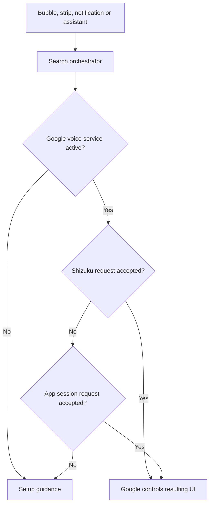
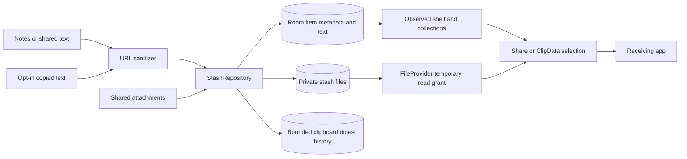

# Architecture and how StashDrop works

This describes the current Kotlin/Jetpack Compose Android app, package `com.vibe.stashdrop`, minimum API 28 and target API 35. It has one local shelf, optional privileged integration, and no application backend. Start with the [feature guide](FEATURE_GUIDE.md) for user instructions.

## Component map

| Area | Responsibility | Implementation |
| --- | --- | --- |
| Dashboard | Home / Shelf / Settings, access status, user actions | [MainActivity](../app/src/main/java/com/vibe/stashdrop/MainActivity.kt), [DashboardScreen](../app/src/main/java/com/vibe/stashdrop/ui/dashboard/DashboardScreen.kt) |
| Floating service | Foreground overlay lifecycle, two edge handles, bounded panel, gesture regions | [OneUiThumbDockService](../app/src/main/java/com/vibe/stashdrop/features/floatingdock/OneUiThumbDockService.kt), [floatingdock](../app/src/main/java/com/vibe/stashdrop/features/floatingdock) |
| Search router | Google request or setup guidance | [CircleToSearchOrchestrator](../app/src/main/java/com/vibe/stashdrop/features/circletosearch/CircleToSearchOrchestrator.kt), [GoogleCircleToSearch](../app/src/main/java/com/vibe/stashdrop/features/circletosearch/GoogleCircleToSearch.kt) |
| Assistant entry | Turns a supported system assist invocation into the same search flow | [AssistActivity](../app/src/main/java/com/vibe/stashdrop/features/circletosearch/AssistActivity.kt) |
| Local data | Room items/history, private attachment files, clean links | [StashRepository](../app/src/main/java/com/vibe/stashdrop/features/stashshelf/StashRepository.kt), [stashshelf](../app/src/main/java/com/vibe/stashdrop/features/stashshelf) |
| Preferences | Persistent settings exposed as a flow | [StashPreferences](../app/src/main/java/com/vibe/stashdrop/features/stashshelf/StashPreferences.kt) |
| Privileged integration | Shizuku connection, user service, explicit assistant/setup changes | [shizuku](../app/src/main/java/com/vibe/stashdrop/core/shizuku) |
| Clipboard | Opt-in remote listener and permitted foreground fallback | [ShizukuClipboardMonitor](../app/src/main/java/com/vibe/stashdrop/features/clipboard/ShizukuClipboardMonitor.kt) |
| Motion | Aurora/metaballs/glass, springs, trajectories, haptics | [shaders](../app/src/main/java/com/vibe/stashdrop/core/shaders), [physics](../app/src/main/java/com/vibe/stashdrop/core/physics), [haptics](../app/src/main/java/com/vibe/stashdrop/core/haptics) |
| Sharing and drag | MIME-aware ClipData, temporary URI grants, card shadow | [dragdrop](../app/src/main/java/com/vibe/stashdrop/features/dragdrop), [VisualLensBridge](../app/src/main/java/com/vibe/stashdrop/features/circletosearch/VisualLensBridge.kt) |
| Diagnostics | Last-crash persistence and user-controlled copying | [diagnostics](../app/src/main/java/com/vibe/stashdrop/core/diagnostics) |

## Search request lifecycle

The fixed request carries Google’s contextual entry point and assist/screenshot flags. Both app and Shizuku identities use `showSessionFromSession` after checking the active voice-service component belongs to Google. Android 15 handles contextual-search requests specially through this API; `showSessionForActiveService` has a separate permission and bypasses that handling. A null session token is allowed by [AOSP Android 15](https://android.googlesource.com/platform/frameworks/base/+/refs/tags/android-15.0.0_r1/services/voiceinteraction/java/com/android/server/voiceinteraction/VoiceInteractionManagerService.java); private API/OEM restrictions can still reject requests. Reflection is best effort across OS versions. Acceptance does not prove Circle to Search appeared; Google may display Gemini instead. There is no capture, OCR or built-in activity fallback.

## Gesture recognition

The overlay service exposes one transparent 88 × 40 dp central search strip, 32 dp above stable system-navigation insets. Only upward swipe/flick is enabled by the live service; legacy gesture preference keys do not restore removed corner/hold/double-tap overlays. The drawing is visible only during active touch. Keyboard/lock/search suspend the strip. Native assistant corner gestures remain Android/OEM-managed and the UI links to assistant settings. Android owns mandatory bottom Home/Recents gestures.

## Local data flow

Text is sanitized and truncated to 100,000 characters. Automatic clipboard saves also hash the cleaned text and check the recent digest history before inserting. This deduplicates the last 100 automatic copies; manual saves do not share that restriction.

File imports copy a readable content URI into private storage, cap each file at 50 MB, and use generated filenames with validated extensions. Import failures remove partial files. Deleting an item deletes its metadata and cached file. Collections are item labels, with **Inbox** as the fallback. DataStore persists booleans and spring intensity independently of the Room database. The native dashboard exposes multi-item selection with batch share/move and confirmed deletion. Interaction preferences have their own page; enabling automatic copied-text saving requires explicit confirmation.

No export/import archive or synchronization service is implemented. Android backup is disabled in the manifest, so users should share out content they need before uninstalling.

## Privileged operations and recovery

`ShizukuConnectionManager` observes binder availability, runtime permission, and user-service connection. The shell user service performs authorized setup/settings operations, Google session requests, and clipboard access. Binder loss changes the connection state; the clipboard monitor observes reconnection and registers again when enabled. Background access remains subject to Android and OEM policy.

Assistant role selection and Google voice-service activation are separate settings. Explicit assistant actions can save a previous role holder, select StashDrop, restore a holder, or link Google's voice service while assistant presses enter StashDrop. This arrangement depends on private/system behavior and should be tested per OS/OEM. The system assistant picker remains available without the bridge.

The foreground overlay service owns its window lifecycle. Gesture markers hide on a locked screen and while the keyboard is shown. User actions and foreground-service access remain constrained by Android's permission and background-start rules. Local crash reporting helps reproduce failures; it does not replace recovery testing.

## Rendering and cross-app boundaries

Compose draws the dashboard and floating shelf. AGSL runtime shaders run on API 33+, with Canvas fallback implementations for older devices. RenderEffect-based effects require supported Android versions and affect app-rendered content. Requesting a high display refresh rate does not guarantee sustained frame throughput.

Spring specifications govern follow/expansion/landing, and the trajectory engine projects drag velocity into cubic Bezier motion. Android's drag framework carries a custom stack shadow plus text/URI ClipData. The receiving app chooses its supported formats and drop targets. StashDrop has no reliable access to another app's internal landing position; flight feedback is confined to its own overlay.

## Data and privacy boundaries

| Data/action | Storage or destination | User control |
| --- | --- | --- |
| Notes, copied text, links | Private Room database | Add/delete in Shelf; clipboard collection off by default |
| Imported files | Private app files | Delete shelf items |
| Clipboard deduplication | Recent digests in Room | Bounded history; shelf text remains separately stored |
| Preferences and previous assistant role | DataStore / app-private preferences | Settings and explicit assistant actions |
| Last crash report | App-private diagnostic storage | Copy or dismiss; no automatic upload |
| Google/Share | External receiving app | Initiated by the user; external service policies apply |

The implementation has no StashDrop account server or cloud shelf sync. App-private storage relies on Android's sandbox; an additional app-managed encrypted vault is not implemented. FileProvider grants selected content rather than making the whole cache public. Clipboard text is not written to logs by the monitor, but saved shelf items may contain secrets if automatic copying is enabled.

## Build, evidence, and limits

The release workflow builds debug checks and signed minified APK/AAB artifacts, verifies the pinned original certificate, signatures, checksums, tests, lint, and alignment, and publishes the five public assets. The private keystore remains outside Git and is restored from protected Actions secrets for release builds. Documentation updates do not change existing release binaries or tags.

See the current versioned verification report for executed test, lint and signature checks. Host renders exercise production visual components with fixtures. Neither those checks nor a successful Binder call establishes universal OEM compatibility, usable Google search, external-app drop success, accessibility quality, or phone performance. See [verification](VERIFICATION.md), [device validation](DEVICE_VALIDATION.md), and [future work](ROADMAP.md).

## Overlay input and media policies (0.7.0)

One small touchable edge window open a bounded rectangular panel. The panel uses `FLAG_NOT_TOUCH_MODAL` and outside-touch notification, so outside input can reach other apps and dismiss the panel. The handles exclude their limited side region from system Back gestures on API 29+; this does not exclude Android’s mandatory bottom navigation.

Search-wave and dismiss-target windows are non-touchable, hidden while idle, and use window alpha 0.35 when visible. Android combines overlapping untrusted opacity as `1 - product(1 - alpha)`: the two decorations combine to 0.5775, below the standard 0.8 touch-blocking threshold. The previous two 0.7 windows combined to 0.91. Checking each window separately missed that interaction.

`ShelfCategory` derives a type from existing MIME/text/collection data without a Room migration. Shared type chips are used by dashboard and panel. `ShelfThumbnails` uses local IO decoding, EXIF-aware image handling, scaled video frame extraction and a 12 MiB LRU cache. Visible components hold at most a 320-pixel preview; offscreen components release their bitmap reference. Unavailable media fails to a placeholder. No remote preview request is made.

The handle edge/relative vertical position is stored in private SharedPreferences. Panel bounds are at most 296 × 420 dp and 78% × 58% of the display. SwipeToDismissBox requests deletion confirmation and returns to the settled position; it never directly removes files. CompatibleDropTargets queries the exact VisualLensBridge share intent, excludes self/non-exported activities, deduplicates packages and presents at most four choices. Target drops use explicit activities and URI grants; prior successful target-strip launches rank future choices without reading system app usage. Target windows are removed after drag end, failure, sheet dismissal or service destruction.
